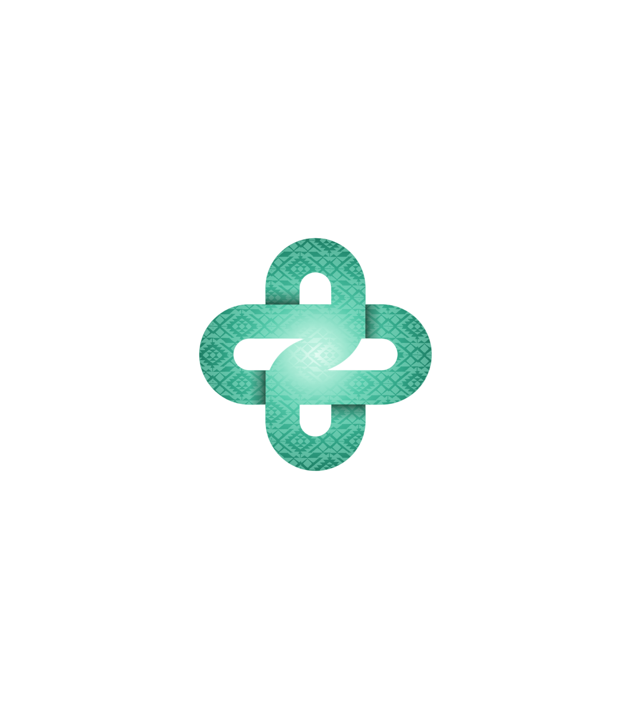
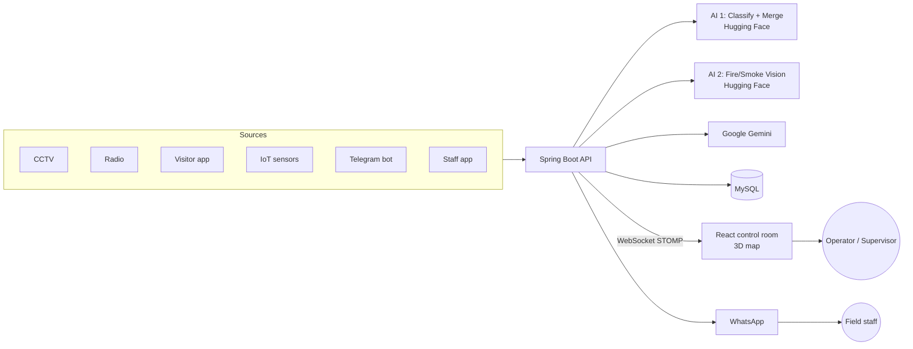
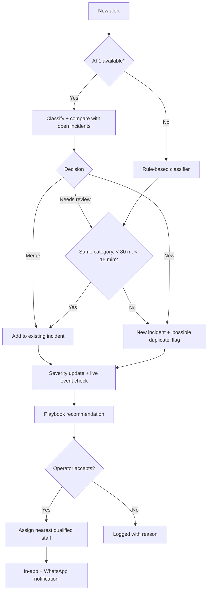

<div align="center">



# Rifd · رِفد

**AI-powered operations center for Expo 2030 Riyadh**

منصة ذكية توحّد تنبيهات مركز عمليات المعرض، تفرزها، وتدمج المتكرر منها في حوادث واضحة

### من 40 تنبيه إلى 3 حوادث · From 40 alerts to 3 incidents

<br>

<a href="https://rifd-frontend.vercel.app/"></a>
&nbsp;
<a href="https://github.com/gTurki/Rifd"></a>
&nbsp;
<a href="https://github.com/gTurki/Rifd-frontend"></a>

<br><br>


</div>

---

> **Expo 2030 Riyadh Challenge** · Track 3: Exhibition Operations, Safety & Security · **Challenge 3.6**
>
> During a live event, the operations center receives hundreds of alerts, radio messages, service requests and system notifications from separate sources, and struggles to tell what needs immediate action. **Rifd** brings them all into one screen, lets AI classify and merge them into incidents on the Expo map, recommends the approved response, and dispatches the nearest qualified staff member.

## 🔗 Project Links

| | Link |
|---|---|
| 🌐 **Live platform** | **[rifd-frontend.vercel.app](https://rifd-frontend.vercel.app/)** |
| 🧠 **Backend repository** (Spring Boot) | **[github.com/gTurki/Rifd](https://github.com/gTurki/Rifd)** |
| 🖥️ **Frontend repository** (React) | **[github.com/gTurki/Rifd-frontend](https://github.com/gTurki/Rifd-frontend)** |
| ⚙️ **Backend API** | [rifd-production.up.railway.app](https://rifd-production.up.railway.app) |

**Demo accounts** (password for all: `demo123`)

| Role | Username |
|---|---|
| Supervisor | `supervisor1` |
| Operator | `operator1`, `operator2` |
| Field staff | staff number, e.g. `C-101` |

Visitors can submit a report from the public page without an account.

## 📑 Table of Contents

- [Features](#-features)
- [AI Inside Rifd](#-ai-inside-rifd)
- [Alert Sources](#-alert-sources)
- [Architecture](#️-architecture)
- [How an Alert Becomes an Incident](#-how-an-alert-becomes-an-incident)
- [Demo Scenario](#-demo-scenario)
- [Tech Stack](#️-tech-stack)
- [Getting Started](#-getting-started)
- [Team](#-team)

## ✨ Features

- **One unified screen**: every alert from every source arrives in real time on a live 3D map of the Expo site.
- **AI triage**: each alert is classified into one of 9 categories (crowd, medical, fire, security, technical failure, accessibility, lost person, cleanliness, other) with a severity level.
- **Smart merging**: duplicate reports about the same event, in Arabic or English, are merged into a single incident instead of flooding the operator.
- **Never goes down**: if any AI service is slow or offline, a rule-based classifier and fixed operational rules take over, so the system keeps working.
- **Live events awareness**: incidents near an ongoing event (concert, ceremony) are automatically raised in severity.
- **Playbook recommendations**: 18 approved response playbooks; the system recommends one and a human operator accepts or rejects it.
- **Nearest qualified staff**: tasks go to the closest available staff member with the right specialty and certification level, with full task tracking.
- **Automatic escalation**: if nobody accepts a task in time, it is reassigned, and supervisors are alerted when no replacement is found.
- **Accessibility first**: when an elevator or ramp fails, the accessibility team is notified, the affected accessible route is marked disrupted, an alternative route is calculated (Dijkstra), and visitors get a message in Arabic and English.
- **Visitor reports with photos and voice**: visitors report problems with up to 3 photos and a voice note, then track their report with a code.
- **Telegram bot**: anyone can report by text, voice or photo, with a reputation system, rate limiting and blocking of false reporters.
- **WhatsApp notifications**: staff receive account details and urgent task assignments, and supervisors receive escalations on WhatsApp.
- **Full audit trail**: the activity log shows which decisions were made by AI, by rules, or by a human.
- **Built-in simulation**: one click replays a realistic live-event scenario for demos and training.
- **Role-based security**: JWT authentication with operator, supervisor and field-staff roles.

## 🧠 AI Inside Rifd

| Component | What it does | How |
|---|---|---|
|  **AI 1: Merge & Team Suggestion model** | Classifies each alert (category + severity), decides whether it belongs to an open incident (**merge**, **needs review**, or **new incident**), and suggests the response team | Built by the team and hosted on Hugging Face. Frozen Arabic sentence embeddings (`Arabic-Triplet-Matryoshka-V2`) + a logistic-regression merge model trained by the team on 5 interpretable features (text similarity, time gap, distance, same zone, same category). Tested on 47 hand-written reports in different dialects that were not in training: **AUC 0.957** and **100% precision** on automatic merges. |
|  **AI 2: ExpoGuard computer vision** | Detects fire and smoke in camera and visitor images | YOLO-based fire/smoke detection hosted on Hugging Face. Smart cameras only raise an alert when something is detected, which means no false alarms from normal footage. |
|  **Google Gemini** | Telegram gatekeeper, voice transcription, photo description | Filters non-report messages, cleans the text, transcribes voice notes, and describes photos before they enter the pipeline. |
| 📏 **Rule-based fallback** | Keeps the system running without AI | Keyword classifier + operational merge rules (same category, within 80 m, within 15 minutes). The dashboard separates AI merges from rule-based merges. |
| 🧭 **Dijkstra routing** | Alternative accessible routes | Calculated locally over the accessible-route graph, with no external API. |

Every AI call is wrapped with a timeout and a fallback, so a failure in any AI service never blocks an alert.

## 📡 Alert Sources

| Source | Example |
|---|---|
| 📹 CCTV | Smart camera detects smoke near a gate |
| 📻 Radio | Security guard reports a crowd building up |
| 📱 Visitor app | Visitor reports a broken elevator with a photo |
| 🌡️ IoT sensors | Occupancy sensor exceeds its limit |
| 🛎️ Service requests | Cleaning request in a pavilion |
|  Telegram | Voice note: "there is smoke near the main stage" |
| 👷 Staff app | Field staff raise a report from their phone |

## 🏗️ Architecture



## 🔄 How an Alert Becomes an Incident



## 🎬 Demo Scenario

1. A live concert is running in the main plaza.
2. The simulation sends **~40 alerts** in two minutes from radio, cameras, visitors and sensors, in Arabic and English, with intentional duplicates.
3. The alert counter climbs, but the map shows only **3 incidents**:
   - **Crowd crush risk (HIGH)** near the concert, raised automatically because of the live event, then a playbook recommendation and assignment to the nearest certified crowd supervisor.
   - **Elevator failure**: the accessibility team is notified, the accessible route is disrupted, an alternative route is calculated, and visitors are informed in Arabic and English.
   - **Minor incident (LOW)**: assigned to a visitor-services assistant.
4. The activity log shows which decisions came from AI and which from humans.

A separate **fire scenario** shows smart cameras detecting smoke and fire with AI 2 while ignoring normal footage.

## 🛠️ Tech Stack

| Layer | Technology |
|---|---|
| Backend | Java 17, Spring Boot 4, Spring Data JPA, Hibernate 7, Spring Security (JWT), Validation, Lombok |
| Real-time | WebSocket (STOMP) |
| Database | MySQL 8 (production), MariaDB (local) |
| Frontend | React 18, Vite 5, three.js (3D map), STOMP.js, custom CSS design system |
| AI | Hugging Face Spaces (AI 1 + AI 2, Python / FastAPI), Google Gemini |
| Messaging | Telegram Bot API, UltraMsg (WhatsApp) |
| Deployment | Railway (backend + MySQL, Docker), Vercel (frontend) |

## 🚀 Getting Started

**Backend** · [github.com/gTurki/Rifd](https://github.com/gTurki/Rifd)

```bash
git clone https://github.com/gTurki/Rifd.git
cd Rifd
./mvnw spring-boot:run
```

Configuration comes from environment variables (all optional locally): `DB_URL`, `DB_USER`, `DB_PASSWORD`, `JWT_SECRET`, `HF_TOKEN`, `TELEGRAM_BOT_TOKEN`, `MEDIA_AI_KEY`, `WHATSAPP_ENABLED`, `ULTRAMSG_INSTANCE`, `ULTRAMSG_TOKEN`. On first run, the `DataSeeder` fills the database with zones, events, staff, playbooks and accessibility data.

**Frontend** · [github.com/gTurki/Rifd-frontend](https://github.com/gTurki/Rifd-frontend)

```bash
git clone https://github.com/gTurki/Rifd-frontend.git
cd Rifd-frontend
npm install
npm run dev
```

Set `VITE_API_URL` in `.env` to the backend URL.

## 👥 Team

<table>
  <tr>
    <td align="center" width="20%" valign="top">
      <a href="https://github.com/gTurki"><br><b>Turki Alghamdi</b></a><br>
      <sub>Backend & Frontend</sub><br><br>
      <sub>Spring Boot API, React control room, integrations, deployment</sub>
    </td>
    <td align="center" width="20%" valign="top">
      <a href="https://github.com/ab-asmari00"><br><b>Abdullah Alasmari</b></a><br>
      <sub>Backend & Frontend</sub><br><br>
      <sub>Spring Boot API, React control room, integrations, deployment</sub>
    </td>
    <td align="center" width="20%" valign="top">
      <a href="https://github.com/raghada30"><br><b>Raghad Alaqeel</b></a><br>
      <sub>UI/UX Design</sub><br><br>
      <sub>Product design, user experience, brand identity</sub>
    </td>
    <td align="center" width="20%" valign="top">
      <a href="https://github.com/Basmaalmuntaser"><br><b>Basma Almuntaser</b></a><br>
      <sub> AI 1: Merge & Team Suggestion</sub><br><br>
      <sub>Merges duplicate alerts into incidents and suggests the response team</sub>
    </td>
    <td align="center" width="20%" valign="top">
      <a href="https://github.com/aljoharhmohammed1-pixel"><br><b>Aljawhara Alnajm</b></a><br>
      <sub> AI 2: Computer Vision</sub><br><br>
      <sub>Fire and smoke detection from camera and visitor images</sub>
    </td>
  </tr>
</table>

---

<div align="center">
<sub>Built for the Expo 2030 Riyadh Challenge · Tuwaiq Academy · October 2026</sub>
</div>
